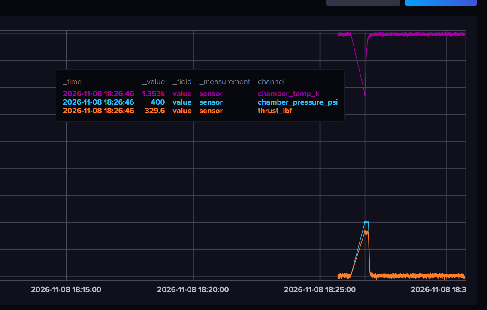

### Results of Server kill

on server.py, a CTRL+C interrupt was executed, stopping the server. `collector.py` was left running, resulting in these messages:

```
Requested session timeout to be 3600000ms, got 600000ms instead
connected to PLC
lost connection: client is disconnected; reconnecting
close_session was called but connection is closed
close_secure_channel was called but connection is closed
connect failed (); retrying in 1s
```

restarted `server.py`, and it connected with the following messages:

```
Requested session timeout to be 3600000ms, got 600000ms instead
connected to PLC
```

### Run database down test

Ran the command `docker compose stop influxdb`, to stop the influxdb, which resulted in `collector.py` printing:

```
The retriable error occurred during request. Reason: '('Connection aborted.', RemoteDisconnected('Remote end closed connection without response'))'.
The retriable error occurred during request. Reason: 'HTTPConnection(host='localhost', port=8086): Failed to establish a new connection: [WinError 10061] No connection could be made because the target machine actively refused it'.
The retriable error occurred during request. Reason: 'HTTPConnection(host='localhost', port=8086): Failed to establish a new connection: [WinError 10061] No connection could be made because the target machine actively refused it'.
```

Resumed using `docker compose start influxdb`. It seems like during downtime, there was some data aberration, as shown here:



We can see that the following is true:
- chamber_pressure_psi (blue): ramps up, holds at 400, then drops sharply
- thrust_lbf (orange): follows the pressure curve at 80% of its height
- chamber_temp_k (purple): climbs toward about 1800 and levels off

This is all a result of the downtime in the influxdb.


### Running tests

Finally, I ran a `pytest` on the project to see if there were any issues, to which there were not. All 3 passed:

```
rootdir: <project location on my C drive, removing path for safety>
plugins: anyio-4.16.0
collected 3 items                                                                                                                                                                                                   

tests\test_signals.py ...                                                                                                                                                                                     [100%]

================================================================================================ 3 passed in 0.09s =================================================================================================
```